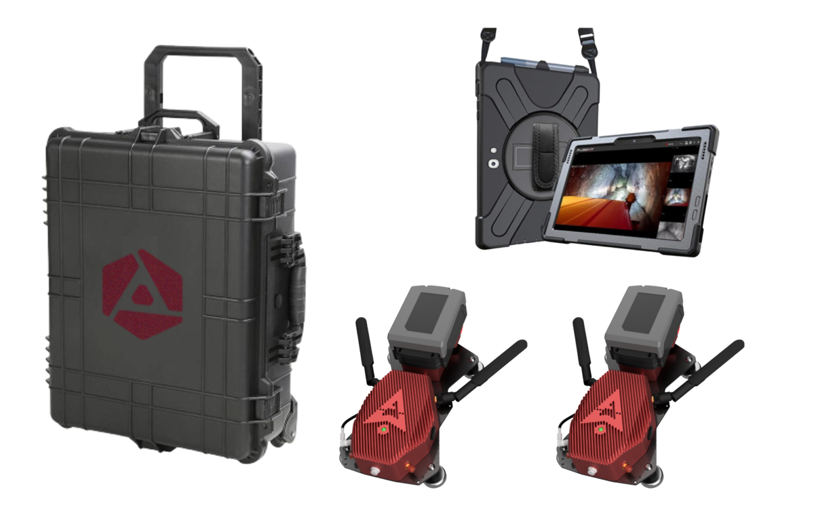
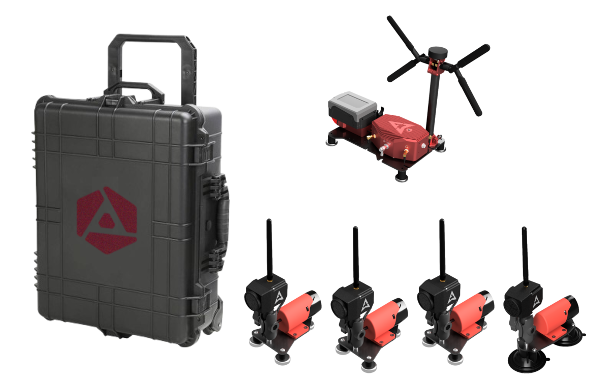

# About VTS

## Overview

This guide will help you deploy, test, and use the Argus Video Training System (VTS). Originally developed for training underground heavy vehicle operators remotely, Argus works equally well for any situation where you need live video feeds deployed quickly. Everything you need comes in durable hard cases designed for fast setup anywhere.

---

## System Key Components

The Argus Video Training System comprises of four main components:

| **Component** | **Description** |
|-----------|-------------|
| **The Argus Software** | Windows-based software platform that gives remote trainers access to multiple video feeds from remote cameras |
| **The Argus Access Points (AP)** | Wireless networking nodes that work together to create a mesh network |
| **Remote Camera Systems (RCS)** | Portable video streaming cameras that quickly attach to training vehicles |
| **Trainers Tablet PC** | Connects to the access points to view camera feeds and save recordings |

## Video Training System Contents

The Video Training System kit comprises of:

---

## Packaging & Deployment Cases

The kit travels in two identical rugged roller cases: one for the trainer position and one for the vehicle.

<table class="image-info-card">
<tr>
<td class="image-info-card-text">
### Trainer Case

Contains:
- Trainer access point
- Repeater access points
- Trainer's tablet and charger
- 18V access point batteries
</td>
<td class="image-info-card-image">

</td>
</tr>
</table>

<table class="image-info-card">
<tr>
<td class="image-info-card-text">
### Machine Case

Contains:
- Four remote camera systems, each with a 12V battery
- Machine access point and 18V battery
- Service cable
- Spare antennas
</td>
<td class="image-info-card-image">

</td>
</tr>
</table>

---

## Battery Charging

A charging system is not included with the VTS kit. We recommend the **Milwaukee M12-18C3 12V - 18V Multi Voltage Rapid 6-Battery Charger Station** for efficient battery management and reduced downtime.

<table class="image-info-card">
<tr>
<td class="image-info-card-text">
### Recommended Charger

**Milwaukee M12-18C3 Multi Voltage Rapid Charger**

**Key Features:**
- Charges three batteries simultaneously
- Accepts up to three M12™ and three M18™ battery packs
- Convenient carrying handle and integrated hang holes
- **3.0Ah Batteries (12V)** charge in 48 minutes
- **5.0Ah Batteries (18V)** charge in 63 minutes
</td>
<td class="image-info-card-image">

</td>
</tr>
</table>

