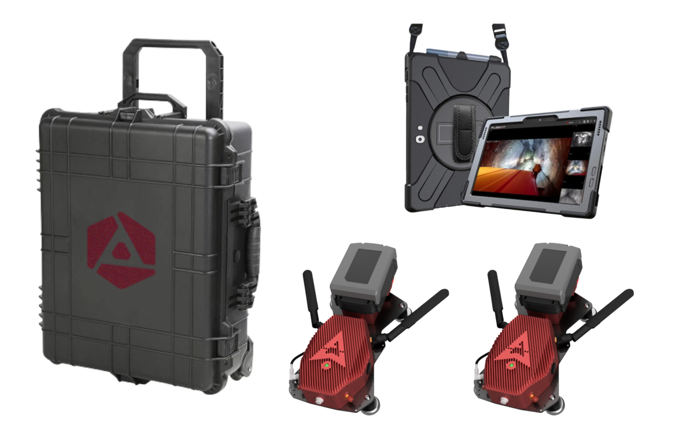
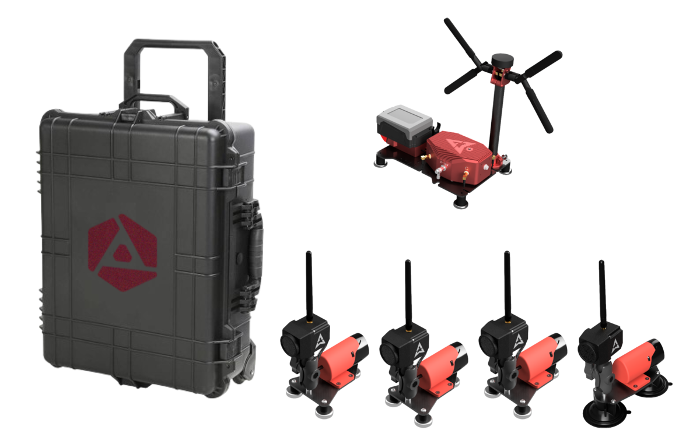

# Acerca del VTS

## Descripción General

Esta guía le ayudará a desplegar, probar y utilizar el Sistema de Capacitación por Video Argus (VTS). Desarrollado originalmente para capacitar de forma remota a operadores de vehículos pesados subterráneos, Argus funciona igualmente bien para cualquier situación en la que necesite transmisiones de video en vivo desplegadas rápidamente. Todo lo necesario viene en maletines resistentes diseñados para una configuración rápida en cualquier lugar.

---

## Componentes Principales del Sistema

El Sistema de Capacitación por Video Argus comprende cuatro componentes principales:

| **Componente** | **Descripción** |
|-----------|-------------|
| **El Argus Software** | Plataforma de software basada en Windows que otorga a los instructores remotos acceso a múltiples transmisiones de video desde cámaras remotas |
| **Los Nodos de Red Argus (AP)** | Nodos de red inalámbrica que trabajan en conjunto para crear una red mesh |
| **Sistemas de Cámara Remota (RCS)** | Cámaras de transmisión de video portátiles que se conectan rápidamente a los vehículos de entrenamiento |
| **Tablet PC del Instructor** | Se conecta a los nodos de red para ver las transmisiones de cámara y guardar grabaciones |

## Contenido del Sistema de Capacitación por Video

El kit del Sistema de Capacitación por Video comprende:

---

## Empaque y Maletines de Despliegue

El kit se transporta en dos maletines con ruedas resistentes e idénticos: uno para la posición del instructor y otro para el vehículo.

<table class="image-info-card">
<tr>
<td class="image-info-card-text">
### Maletín del Instructor

Contiene:
- Punto de acceso del instructor
- Puntos de acceso repetidores
- Tablet del instructor y su cargador
- Baterías de 18V para los puntos de acceso
</td>
<td class="image-info-card-image">

</td>
</tr>
</table>

<table class="image-info-card">
<tr>
<td class="image-info-card-text">
### Maletín de Máquina

Contiene:
- Cuatro sistemas de cámara remota, cada uno con una batería de 12V
- Punto de acceso de máquina y batería de 18V
- Cable de servicio
- Antenas de repuesto
</td>
<td class="image-info-card-image">

</td>
</tr>
</table>

---

## Carga de Baterías

El kit VTS no incluye un sistema de carga. Recomendamos la **Estación de Carga Rápida Multi-Voltaje Milwaukee M12-18C3 12V - 18V para 6 Baterías** para una gestión eficiente de baterías y menor tiempo de inactividad.

<table class="image-info-card">
<tr>
<td class="image-info-card-text">
### Cargador Recomendado

**Cargador Rápido Multi-Voltaje Milwaukee M12-18C3**

**Características Principales:**
- Carga tres baterías simultáneamente
- Acepta hasta tres paquetes de batería M12™ y tres M18™
- Cómodo asa de transporte y orificios de colgado integrados
- **Baterías 3.0Ah (12V)** se cargan en 48 minutos
- **Baterías 5.0Ah (18V)** se cargan en 63 minutos
</td>
<td class="image-info-card-image">

</td>
</tr>
</table>

