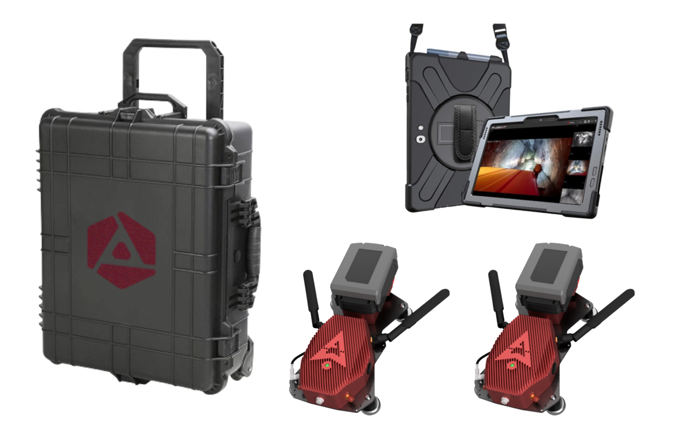
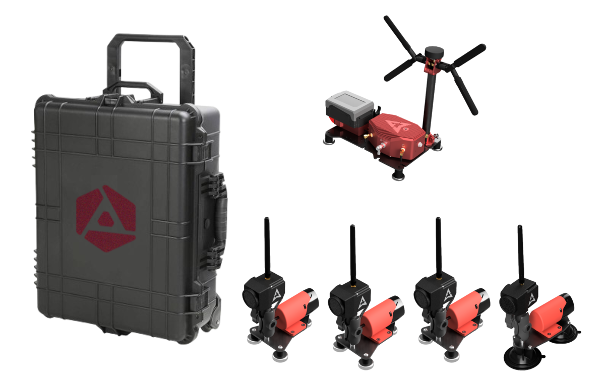

# Giới Thiệu VTS

## Tổng Quan

Hướng dẫn này sẽ giúp bạn triển khai, kiểm tra và sử dụng Hệ Thống Đào Tạo Video Argus (VTS). Ban đầu được phát triển để đào tạo từ xa cho người vận hành xe hạng nặng dưới lòng đất, Argus hoạt động tốt trong mọi tình huống cần triển khai nguồn video trực tiếp nhanh chóng. Tất cả thiết bị cần thiết được đóng gói trong các hộp cứng bền, thiết kế để lắp đặt nhanh ở bất kỳ đâu.

---

## Các Thành Phần Chính

Hệ Thống Đào Tạo Video Argus bao gồm bốn thành phần chính:

| **Thành Phần** | **Mô Tả** |
|-----------|-------------|
| **Phần Mềm Argus** | Nền tảng phần mềm trên Windows cho phép huấn luyện viên từ xa truy cập nhiều luồng video từ camera từ xa |
| **Điểm Truy Cập Argus (AP)** | Các nút mạng không dây hoạt động cùng nhau để tạo mạng mesh |
| **Hệ Thống Camera Từ Xa (RCS)** | Camera phát video di động gắn nhanh vào xe đào tạo |
| **Máy Tính Bảng Huấn Luyện Viên** | Kết nối với điểm truy cập để xem luồng camera và lưu bản ghi |

## Nội Dung Bộ Kit VTS

Bộ kit Hệ Thống Đào Tạo Video bao gồm:

- Máy tính bảng huấn luyện viên
- Điểm truy cập huấn luyện viên
- Điểm truy cập lặp: tối đa ba mỗi bộ kit (đa số bộ kit có hai)
- Điểm truy cập máy
- Bốn hệ thống camera từ xa: ba camera gắn nam châm và một camera cabin gắn giác hút

---

## Hộp Đựng & Triển Khai

Bộ thiết bị được vận chuyển trong hai vali kéo chắc chắn giống hệt nhau: một cho vị trí huấn luyện viên và một cho phương tiện.

<table class="image-info-card">
<tr>
<td class="image-info-card-text">
### Hộp Huấn Luyện Viên

Bao gồm:
- Điểm truy cập huấn luyện viên
- Các điểm truy cập lặp (tối đa ba; đa số bộ kit có hai)
- Máy tính bảng huấn luyện viên và bộ sạc
- Pin 18V cho điểm truy cập
</td>
<td class="image-info-card-image">

</td>
</tr>
</table>

<table class="image-info-card">
<tr>
<td class="image-info-card-text">
### Hộp Máy

Bao gồm:
- Bốn hệ thống camera từ xa, mỗi hệ thống có một pin 12V
- Điểm truy cập máy và pin 18V
- Cáp bảo trì
- Anten dự phòng
</td>
<td class="image-info-card-image">

</td>
</tr>
</table>

---

## Sạc Pin

Hệ thống sạc không được bao gồm trong bộ kit VTS. Chúng tôi khuyến nghị sử dụng **Trạm Sạc Nhanh Milwaukee M12-18C3 12V - 18V Multi Voltage 6 Pin** để quản lý pin hiệu quả và giảm thời gian ngừng hoạt động.

<table class="image-info-card">
<tr>
<td class="image-info-card-text">
### Bộ Sạc Khuyến Nghị

**Milwaukee M12-18C3 Multi Voltage Rapid Charger**

**Tính Năng Chính:**
- Chứa tối đa sáu bộ pin: ba M12™ (camera) và ba M18™ (điểm truy cập)
- Sạc ba bộ pin cùng lúc
- Tay cầm tiện lợi và lỗ treo tích hợp
- **Pin 3.0Ah (12V)** sạc trong 48 phút
- **Pin 5.0Ah (18V)** sạc trong 63 phút
</td>
<td class="image-info-card-image">

</td>
</tr>
</table>

